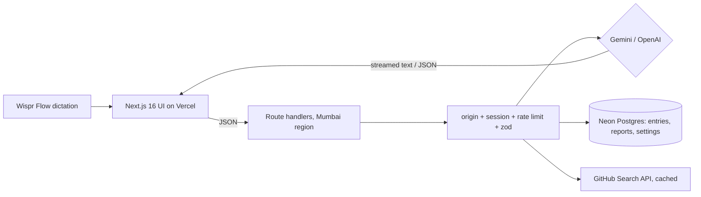

# ShipLog: talk about your day, ship your standup

> A voice-first work journal for software engineers. Hold your **Wispr Flow** key, ramble about your day for 30 seconds (Hinglish welcome), and ShipLog turns it into a clean log, cross-checks it against your GitHub commits, and writes your **standup**, **weekly report** and **appraisal brag doc**.

**Live:** https://SHIPLOG-URL · **Demo video:** https://VIDEO-LINK

## Try it (no sign-up)

| Option                         | How                                                                                                                                                 |
| ------------------------------ | --------------------------------------------------------------------------------------------------------------------------------------------------- |
| **One-tap demo (recommended)** | Click **"Try the demo"**. You get a private account pre-filled with two weeks of sample logs, so reports, the timeline and search work immediately. |
| **Shared demo account**        | `demo@shiplog.dev` / `shiplog-demo-2026`                                                                                                            |
| **Your own account**           | Click **"New here? Create an account"**                                                                                                             |

## The problem (mine)

I'm a frontend engineer. Every day I write a standup, every Friday a weekly update, and at appraisal time I try to remember six months of work, usually badly. Writing these is slow and boring, so they end up vague ("worked on dashboard"). **Talking** about my day is easy. ShipLog makes the spoken version the source of truth.

**Who it's for:** individual engineers who post async standups (Slack/Teams), write weekly reports for a manager, and need a record of impact for reviews.

## How it works

1. **Today:** dictate your day into one box with Wispr Flow. ShipLog's AI structures it into **Done / In progress / Blockers / Tomorrow** with project tags.
2. **GitHub cross-check:** ShipLog reads your public commits and PRs for the day and flags work you shipped but forgot to mention ("Missed from GitHub"). One click adds it.
3. **Blocker → ticket:** turn any blocker or to-do into a GitHub issue draft with acceptance criteria, then open it pre-filled in GitHub.
4. **Reports:** a standup (Slack, Teams or plain), a weekly report, or a brag doc for any period. Unchanged logs return the saved report instantly.
5. **Timeline:** a contribution heatmap, streaks and stats.
6. **Ask your journal:** _"When did I last work on onboarding?"_ answered from your own entries with dates.

## How I used Wispr Flow

- **Building:** I built ShipLog by voice. Prompts to my AI coding assistant, product decisions, commit messages, this README and my build-in-public posts were dictated with Wispr Flow (see my usage card).
- **In the product:** Wispr Flow is the input method. ShipLog's main screen is one large text box designed for dictation: rambling, Hinglish and filler words are expected, and the AI writes clean professional English from it.

## GenAI services used and where

| Where               | Model                                               | Purpose                                                  |
| ------------------- | --------------------------------------------------- | -------------------------------------------------------- |
| `POST /api/entries` | Google Gemini `gemini-3.5-flash`, structured output | Spoken log → validated sections + "missed from GitHub"   |
| `POST /api/reports` | Gemini, streaming                                   | Standup / weekly report / brag doc                       |
| `POST /api/tickets` | Gemini, structured output                           | Blocker → GitHub issue draft                             |
| `POST /api/ask`     | Gemini, streaming, grounded                         | Answers from your entries (Postgres full-text retrieval) |

OpenAI `gpt-5.4-mini` is an automatic fallback (`AI_PROVIDER`).

## Architecture



## Engineering

**Security**

- scrypt password hashing, and HS256 JWT sessions in an `HttpOnly; Secure; SameSite=Lax` cookie.
- Origin-checked mutations (CSRF), per-user rate limits, and zod validation of every body and query.
- Every SQL query is parameterised and scoped to the session user. DB rows are re-validated on read.
- Prompt-injection guard: user text is wrapped as data. "Missed" GitHub links are only kept if they are really in the user's activity.
- Strict CSP and security headers. GitHub access is read-only and public-only (no OAuth tokens stored).

**Efficiency**

- **No zod or server code in the browser bundle.** Domain types are plain TS, and an ESLint rule blocks client imports of `zod` and server modules.
- **Reports are cached in Postgres** by a hash of their input: reopening an unchanged report is one indexed lookup, not a model call.
- GitHub responses are cached for 5 minutes. Commit and PR searches run in parallel.
- **SQL does the heavy lifting:** heatmap counts are aggregated with `GROUP BY`, date ranges use the `(user_id, date)` index, and "Ask" retrieves with a GIN full-text index instead of sending the whole journal to the model.
- Per-task output caps and low reasoning effort. Streaming renders are batched per animation frame, and markdown parsing is memoised.
- Demo accounts are seeded with one bulk `INSERT … SELECT unnest(…)`.

**Accessibility:** semantic landmarks, a skip link, labelled controls, `aria-live` AI output, a keyboard-operable heatmap, WCAG AA contrast in light and dark (muted text is darkened from the brand grey to pass), and reduced-motion support.

**Testing:** Vitest unit and route tests (AI mocked), Playwright end-to-end (desktop + mobile), and axe WCAG scans of every screen in both themes. CI runs lint, dead-code check (knip), typecheck, tests and build.

## Run locally

```bash
pnpm install
cp .env.example .env.local   # add GEMINI_API_KEY, DATABASE_URL, AUTH_SECRET
pnpm db:migrate
pnpm dev
```

## Tech

Next.js 16 · React 19 · TypeScript · Tailwind v4 · shadcn/ui · Vercel AI SDK · Google Gemini · Neon Postgres · GitHub REST API · Vitest · Playwright · axe-core. Design system: Vercel's Geist, via DESIGN.md from getdesign.md.
